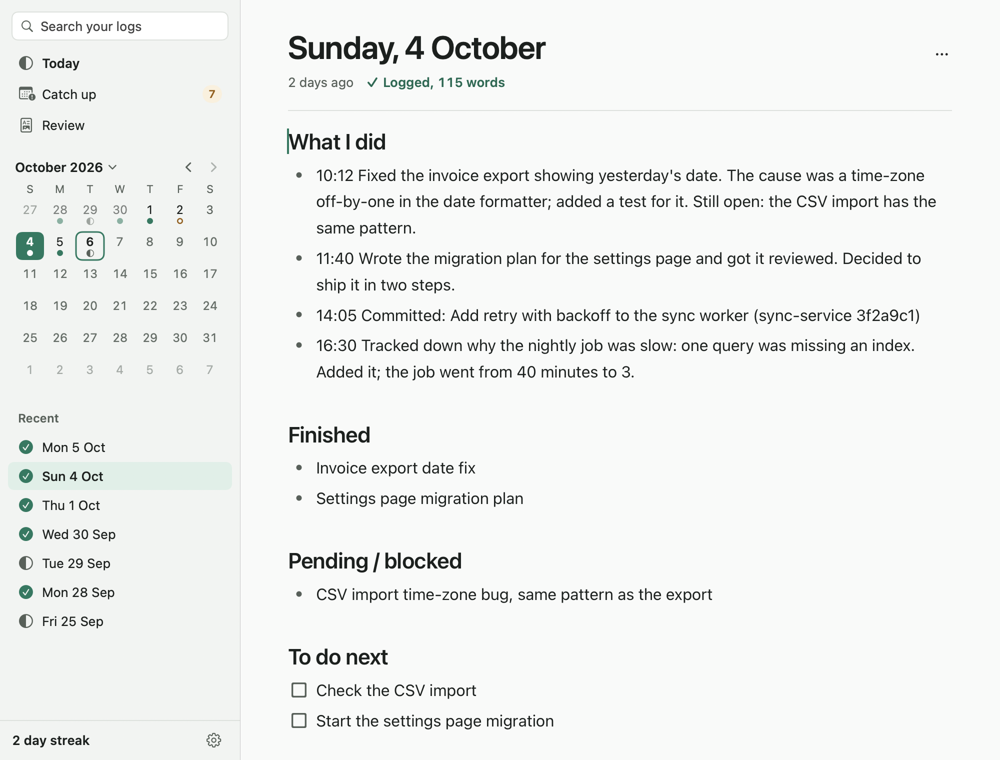
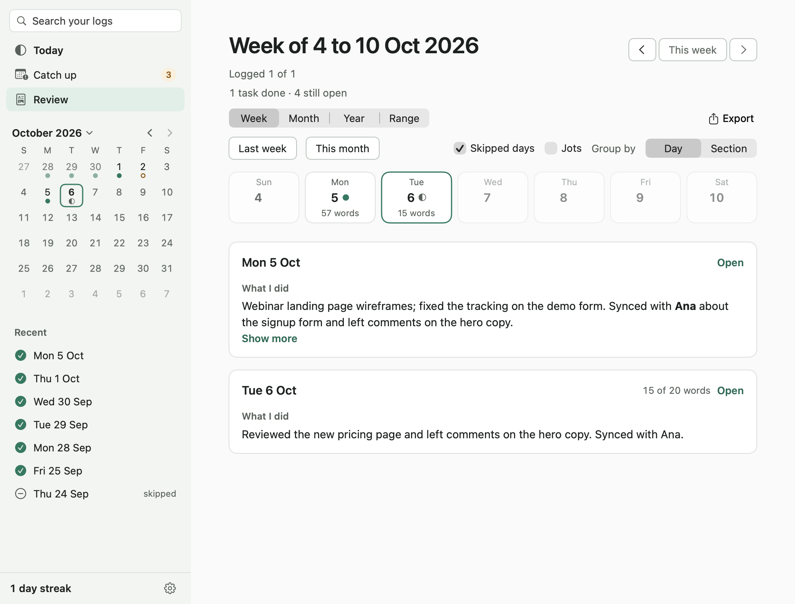

# Gloamlog

Gloamlog is a free, open-source work journal for macOS that keeps one plain markdown file per day, and can have your log written for you from Claude Code and Git while everything stays on your Mac.



> **Alpha (v0.6.5).** It works and the core logic has automated tests, but several newer features have had little use on real Macs. Expect rough edges and please [report them](https://github.com/dasariprashant0/gloamlog/issues/new/choose). The release is a universal binary (Apple silicon and Intel; the Intel half has not been run on a real Intel Mac), requires macOS 13 or later, and is **not notarised** (see [docs/INSTALL.md](docs/INSTALL.md) for why and what that means on first launch).

## Why

- **The end-of-day note is the one nobody writes.** Standups, weekly updates, performance reviews and "what was I doing on Friday?" all need it. Gloamlog makes it one quiet page a day, with a reminder, a catch-up list for days you missed, and a streak that forgives backfilled days.
- **Your notes are just files.** One markdown file per day in a folder you choose. No database, no account, no export step. Open them in any editor, sync them with iCloud Drive or Dropbox, keep them in git.
- **The log can write itself, locally.** Connect Claude Code and it adds a short "what I solved, what I did, what's open" entry to today's page when a piece of work is done. Turn on Git and your commits and pull requests show up too. Nothing is uploaded anywhere by Gloamlog.

## Install

**1. Installer (recommended).** It downloads the latest GitHub release, verifies the published SHA-256, installs to `/Applications` and removes the quarantine flag from that app only.

```bash
curl -fsSL https://raw.githubusercontent.com/dasariprashant0/gloamlog/main/install.sh | bash
```

Prefer to read it first? Download it, open it, then run it: `curl -fsSL https://raw.githubusercontent.com/dasariprashant0/gloamlog/main/install.sh -o install.sh`, then `bash install.sh`. To remove the app later: `bash install.sh --uninstall`. That removes the app and never your notes.

**2. Manual download.** Get `Gloamlog.zip` from the [latest release](https://github.com/dasariprashant0/gloamlog/releases/latest), unzip it, and drag `Gloamlog.app` to `/Applications`. Because the app is not notarised, macOS blocks the first launch of a browser-downloaded copy; the steps to allow it, and how to check the checksum by hand, are in [docs/INSTALL.md](docs/INSTALL.md).

**3. Build from source.** Needs macOS 13+ and the Xcode Command Line Tools (`xcode-select --install`). Full Xcode is not required.

```bash
git clone https://github.com/dasariprashant0/gloamlog.git
cd gloamlog
bash app/build.sh        # builds app/Gloamlog.app (universal, ad-hoc signed); GLOAMLOG_NATIVE=1 builds for this Mac only, twice as fast
open app/Gloamlog.app    # a copy you built yourself opens without the Gatekeeper prompt
```

Once installed, "Check for Updates…" in the Gloamlog menu fetches newer releases (see [Privacy](#privacy)).

## What it does



- **A page per day.** Headings, bullets, to-dos, quotes, code, tables, links and images; type `/` for the block menu. It autosaves and keeps versioned safety copies you can restore. New days can start from a template of headings you control. A day counts as "logged" once you write enough words (you set the number).
- **Any date, and catch-up.** A month calendar opens any day. `⇧⌘T` jumps by typing `last fri`, `2 oct` or `-3`. Catch Up lists the workdays you missed and walks you through them; you can skip holidays or leave in bulk, with undo.
- **Quick capture.** Press `⌃⌥J` in any app, type a line, press Return. It lands as a time-stamped bullet on today's page, even if that page is open. A write-ahead journal means a note is not lost if the app is closed or crashes. You can change or turn off the shortcut in Settings > Shortcuts.
- **Reviews and export.** Review a week, month, year or any date range. Copy it as Markdown, plain text or rich text, save it as PDF, or export Markdown with only the images you used.
- **Reminders.** A strict or gentle end-of-day reminder with snooze, delivered as system notifications.
- **Folder sync.** Point the log folder at iCloud Drive or Dropbox and use two Macs. Gloamlog watches the folder, does not treat a not-yet-downloaded day as empty, and resolves "conflicted copy" files with Keep mine, Take theirs or Keep both. It does not delete either copy.

## Let Claude write your log

Settings > Sources > **Connect Claude Code** sets up a small helper so that Claude Code can add a short entry to today's page when a meaningful piece of work is finished: the problem it was solving, what it did, what is still open.

What the button changes, after showing you a confirmation that lists it:

1. Registers the helper with Claude Code for all your projects. This is the same as running `claude mcp add --scope user gloamlog -- python3 <path to the helper in the app>`.
2. Adds a short section to `~/.claude/CLAUDE.md`, between `<!-- gloamlog:begin -->` and `<!-- gloamlog:end -->`, that tells Claude when to write an entry. If your file already mentions `log_work`, it is left alone.
3. Sets "Jots go under" to "What I did" if it still has its default, so entries sit with the rest of your day.

Start a new Claude Code session afterwards. The helper is one Python file using only the standard library (it needs `python3`, which the Command Line Tools provide). It has one tool, `log_work`, which writes a small JSON file to `~/Library/Application Support/Gloamlog/inbox`. Gloamlog picks it up (while it is running, about every 15 seconds, or at launch) and adds it to today's page. The helper makes no network requests. Claude writes the sentence, so read what it adds and edit it like any other line.

**To undo it:** click Disconnect in Settings > Sources. By hand: `claude mcp remove gloamlog -s user`, then delete the block between the two `gloamlog` comment markers in `~/.claude/CLAUDE.md`. Disconnect does not change "Jots go under".

**By hand instead of the button** (if you installed the app to `/Applications`):

```bash
claude mcp add --scope user gloamlog -- python3 /Applications/Gloamlog.app/Contents/Resources/claude/gloamlog-mcp.py
```

You then have to write the `CLAUDE.md` instruction yourself; the text the button adds is in `app/Core/ClaudeMd.swift`.

**Git and commits.** Also in Sources, and off by default: turn on Claude Code or Git reading and Gloamlog can list what you worked on from your Claude Code session files and `git log`, for the projects you tick. "Add commits for me" writes today's commits and pull requests into your page as you work. Details of exactly what is read are in [PRIVACY.md](PRIVACY.md).

## How your data is stored

- Notes: `~/Gloamlog/YYYY-MM-DD.md`, one file per day, in a folder you can change in Settings > Storage. Pasted or dropped images go in an `assets/` folder next to them.
- Safety copies, the quick-capture journal and the Claude inbox: `~/Library/Application Support/Gloamlog/`, outside your notes folder so they never sync with it.
- Settings: stored by macOS for the app.

## Privacy

- No account, no analytics, no telemetry, no crash reporting.
- The one network request the app can make is **Check for Updates…**, and only when you click it: it asks `api.github.com` for the latest release and, if you accept, downloads the zip and its checksum from `github.com`. Nothing about you is sent.
- The page editor is bundled in the app and runs under a Content-Security-Policy that blocks network access.
- Reading Claude Code sessions and Git is off until you turn it on, is read-only, redacts secrets, and stores nothing from what it reads.

Full detail in [PRIVACY.md](PRIVACY.md).

## Keyboard shortcuts

| | |
|---|---|
| Jot from any app | `⌃⌥J` (changeable) |
| Today / Catch Up / Week Review | `⌘T` / `⌘2` / `⌘3` |
| Month review / Year review / Export | `⌘4` / `⌘5` / `⇧⌘E` |
| Previous / next day | `⌘[` / `⌘]` |
| Go to date | `⇧⌘T` |
| Next / previous unlogged day | `⌘↩` / `⌥⌘↑` |
| Focus the page / Save now | `⌘E` / `⌘S` |
| Carry over from yesterday | `⇧⌘Y` |
| Skip day / Remind me later | `⇧⌘K` / `⇧⌘L` |
| Search logs / next / previous result | `⌘F` / `⌘G` / `⇧⌘G` |
| Copy as Markdown / Open log folder | `⇧⌘C` / `⇧⌘O` |
| Settings | `⌘,` |

Every one is also a menu item.

## Known rough edges

- **Not notarised.** The first launch of a browser-downloaded copy needs an extra approval. The installer and the in-app updater avoid it.
- **Intel is untested.** The release is a universal binary, but it has only been run on Apple silicon.
- **Little real-world use** so far for quick capture over full-screen apps, reminders while the app is quit, iCloud placeholder files, and reading Claude Code sessions. The Claude Code session format is not a documented interface and may change under Gloamlog.
- **Shortcut clashes.** macOS lets two apps register the same global shortcut, so Gloamlog cannot warn you about a clash with another app (it does refuse shortcuts macOS itself owns).
- **Search** scans every file. It is fine for years of logs and will be slow for a decade.
- **Time zones.** The day boundary follows the current time zone, so travelling can show an odd "today".

## Roadmap

No dates. Faster search for very large logs, fixes from real use, and more testing of the features above. Notarisation costs a paid Apple developer account, which this free project does not have; if that changes it will be in the release notes. Ideas and bug reports are welcome in [issues](https://github.com/dasariprashant0/gloamlog/issues).

## Contributing

Read [CONTRIBUTING.md](CONTRIBUTING.md). In short: `bash app/build.sh` builds, `bash tests/run-tests.sh` runs the tests, and the app must keep building with the Command Line Tools alone (no Xcode project, no Swift Package Manager, no Swift macros) and without network code or third-party dependencies. Security problems: [SECURITY.md](SECURITY.md).

More docs: [About](docs/ABOUT.md) · [How it works](docs/EXPLANATION.md) · [File structure](docs/FILE_STRUCTURE.md) · [Architecture](docs/v1/ARCHITECTURE.md) · [Editor contract](docs/EDITOR_CONTRACT.md) · [Changelog](CHANGELOG.md)

## Licence

[MIT](LICENSE). Third-party code in the editor is MIT-licensed and listed in [THIRD_PARTY_LICENSES.md](THIRD_PARTY_LICENSES.md). Not affiliated with Anthropic.
